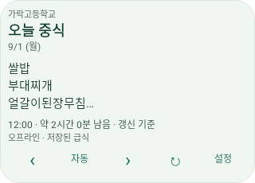
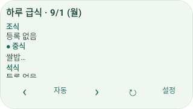

# 한눈급식

### 오늘 뭐 먹지? 홈 화면에서 한눈에.

전국 초·중·고 급식을 날짜별로 확인하고, 
내 일정에 맞는 다음 급식을 위젯으로 확인하세요.

**[Android APK 내려받기](https://github.com/Mangom72/hannun-meal/releases/latest/download/hannun-meal.apk)**

Android 8.0 이상 · 로그인 없이 시작

[릴리스 기록](https://github.com/Mangom72/hannun-meal/releases) · [변경사항](CHANGELOG.md) · [문제 제보](https://github.com/Mangom72/hannun-meal/issues)

---

## 학교만 고르면, 급식 확인 준비 끝

**오늘부터 한 주까지** 
날짜와 조식·중식·석식을 골라 메뉴를 확인하세요. 주간 화면에서는 여러 날짜의 급식을 비교할 수 있습니다.

**내 시간에 맞는 다음 급식** 
시간에 따라 표시할 급식이 자동으로 바뀝니다. 식사 시간을 조정하거나, 원하는 식사로 고정하고 제외 요일을 정할 수도 있어요.

**알레르기와 영양 정보도 함께** 
알레르기 번호와 식품명, 열량·영양·원산지, NEIS 원문을 함께 확인하세요.

**받아 둔 급식은 오프라인에서도** 
저장된 자료를 먼저 보여 주고 새로 갱신합니다. 연결이 끊기거나 조회에 실패해도 기존 메뉴를 지우지 않습니다.

## 세 단계로 시작하세요

1. **APK 설치하기** 
   위의 APK를 Android 기기에 내려받아 여세요. Android가 요구하면 브라우저나 파일 앱의 설치 허용을 확인한 뒤, 시스템 설치 화면에서 직접 승인합니다.
2. **우리 학교 선택하기** 
   학교명이나 지역으로 검색하고 주소를 확인해 선택하세요. 로그인·개인 API 키·서버 주소 입력은 필요하지 않습니다.
3. **급식 확인하기** 
   **오늘**에서 날짜·식사를 고르거나 **주간**에서 한 주를 살펴보세요. **설정 → 자동 전환과 식사 시간**에서 내 일정에 맞출 수 있습니다.

## 앱을 열지 않아도, 홈 화면에서

**다음 급식 · 하루 급식 · 주간 선택 급식 · 주간 전체 급식**의 네 가지 위젯을 제공합니다. 위젯마다 학교와 일정, 표시 항목, 색상·불투명도·글자 크기를 따로 설정할 수 있습니다.

홈 화면의 **위젯 → 한눈급식**에서 추가한 뒤, 위젯의 **설정**을 열어 구성을 마치세요.

### 위젯 표시 예시

아래는 **과거 렌더링 검증용 이미지**입니다. 예시 메뉴이며, 현재 급식이나 최신 버전의 앱 전체 화면을 나타내지 않습니다.

**다음 급식** — 한 끼 메뉴와 다음 식사 탐색

**하루 급식** — 조식·중식·석식의 등록 상태

작은 위젯에서는 일부 정보가 요약됩니다. 절전 설정이나 런처에 따라 갱신이 늦어질 수 있으며, 정각 전환을 보장하지는 않습니다.

## 자주 묻는 질문

**인터넷 없이도 쓸 수 있나요?** 
이미 받아 둔 급식만 확인할 수 있습니다. 처음 학교 목록을 받거나 새로운 급식을 조회할 때는 인터넷 연결이 필요합니다.

**급식이 없거나 학교 안내와 다르면요?** 
NEIS 자료의 등록·수정 시점이나 서비스 상태에 따라 늦거나 누락될 수 있습니다. 아직 조회하지 못한 상태와 조회 결과 급식이 없는 상태를 구분하며, 임의 메뉴를 만들지 않습니다. 알레르기 등 중요한 사항은 반드시 학교 안내도 확인하세요.

**학교와 화면 설정을 바꿀 수 있나요?** 
**설정 → 학교 선택**에서 학교를 바꿀 수 있습니다. 밝은·어두운·시스템 테마, 색상 프리셋과 글자 크기를 지원하며, Android 12 이상에서는 동적 색상도 사용할 수 있습니다.

**업데이트는 어떻게 하나요?** 
**설정 → 앱 업데이트**에서 공개 GitHub 릴리스를 확인할 수 있습니다. APK를 검증한 뒤 Android 설치 화면으로 연결하며, 최종 설치는 사용자가 직접 확인해야 합니다.

## 데이터와 문의

급식·학교 정보는 [NEIS 교육정보 개방 포털](https://open.neis.go.kr/) 자료를 사용합니다. 한눈급식은 **교육기관과 독립적으로 만든 앱**으로, 공식 앱이나 인증·제휴 서비스가 아닙니다. 저장된 자료를 재사용하므로 새로고침이 항상 실시간 재조회를 뜻하지는 않습니다.

불편한 점이나 개선 제안은 [GitHub Issues](https://github.com/Mangom72/hannun-meal/issues)에 남겨 주세요. 앱 버전·Android 버전·재현 방법을 적어 주시면 도움이 됩니다. 개인정보나 키·토큰은 포함하지 마세요.

---

[개발·빌드 안내](docs/DEVELOPMENT.md) · [아키텍처](docs/ARCHITECTURE.md) · [데이터 서비스 배포](docs/DEPLOY-DATA.md)

현재 저장소에는 프로젝트 라이선스를 명시한 `LICENSE` 파일이 없습니다. 코드의 이용·수정·재배포 조건은 저장소 소유자에게 확인해 주세요.
