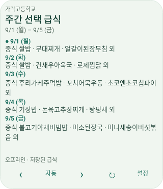
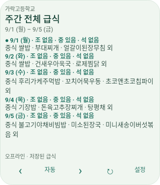

# 초기 1.0.0 테스트 기록

이 문서는 이전 버전의 역사적 결과입니다. 현재 APK·해시는 [최신 검증](TESTING.md)을 참조하세요.

검증일: **2026-10-26**, 최종 소스 기준. 개인 인증키·실기기 없이도 빌드되는 구성입니다.

## 실제 실행 결과

최종 명령(이 클라우드 환경의 로컬 JDK와 프록시 경로):

```sh
JAVA_HOME=/workspace/.tools/jdk17 ./gradlew --no-daemon \
  -Dhttps.proxyHost=proxy -Dhttps.proxyPort=8080 \
  -Dhttp.proxyHost=proxy -Dhttp.proxyPort=8080 \
  testDebugUnitTest lintDebug assembleDebug
```

**BUILD SUCCESSFUL in 2m 29s** · 60 actionable tasks: 17 executed, 43 up-to-date.

일반 개발 환경에서는 프록시 옵션 없이 다음 명령을 실행합니다.

```sh
./gradlew testDebugUnitTest lintDebug assembleDebug
```

| 검사 | 실제 결과 |
| --- | --- |
| Gradle wrapper 다운로드·SHA-256 검증 | 성공, Gradle 8.13 |
| 의존성 해석 및 Kotlin/Java 컴파일 | 성공 |
| JUnit / Robolectric | **61개 통과, 실패 0, 오류 0, 건너뜀 0** |
| Android lint | **오류 0, 경고 59**, task 성공 |
| debug APK | 생성 성공, 14,239,254 bytes |
| apksigner verify --verbose | 종료 코드 0, APK Signature Scheme v2 검증 성공 |
| zipalign -c -P 16 4 | 종료 코드 0 |
| APK manifest / badging | 패키지 kr.han.meal, minSdk 26, targetSdk 36, 버전 1.0.0 |
| 네이티브 위젯 렌더 | 4종 × 4크기 = 16 PNG 생성, 설정 버튼 경계 검사 통과 |
| adb devices -l | 연결된 기기 없음 |
| 에뮬레이터·실기기 instrumented test | 실행하지 못함 |

빌드 로그: [gradle.txt](verification/gradle.txt). 기계 판독 결과: [results.json](verification/results.json).

APK: `app/build/outputs/apk/debug/app-debug.apk`

SHA-256:

```text
3bd97d9b2970c8908a11cb41d8d165b8d2b34210ed2e4b77c3d18989fbe7e15b
```

lint 경고는 API별로 무시되는 하위 호환 메타데이터, 한국어 전용 XML 미리보기 문구, 최신 의존성 알림, KTX 권장 및 테마 아이콘 탐지에 관한 항목입니다. 현재 빌드를 막는 API 호환성 오류는 없습니다. API 33용 monochrome 아이콘은 별도 리소스로 제공합니다. 경고를 없애기 위한 전역 baseline/abortOnError 비활성화는 사용하지 않았습니다.

## 테스트 구성

| 클래스 | 개수 | 내용 |
| --- | --- | --- |
| MealSelectorTest | 35 | 07:59/08:00/12:59/13:00/18:59/19:00, 자정, 금→월, 월·연말·윤년, 식사 제외, 결식 정책, 연속 결식, 미조회/오류 구분, 21일 종료, 규칙 겹침/공백/자정 통과, 고정 식사 유지, 수동 복귀, Seoul 시간대, 식사 시간·elapsedRealtime |
| NeisTest | 12 | 학교 식별자, optional 필드, INFO-200, 인증 실패, 잘못된 envelope/학교, HTML·엔티티·알레르기·중복, 실제 공개 응답 캡처, MockWebServer 페이지네이션·쿼리 파라미터, 키 없는 요청 차단 |
| PersistenceTest | 7 | Room 다중 학교·복합 키, 실패 시 메뉴·조회 범위 보존, 동시 겹침 조회 재사용, 로컬 전환의 API 호출 0건, 미조회 실패 구분, DataStore ID별 독립·재조회·삭제, 수동 탐색·복귀 |
| WidgetContractTest | 5 | 4종 provider 메타데이터·구성 Activity, RemoteViews·Chronometer inflate, 인스턴스/액션별 PendingIntent, 잘못된 ID 구성 취소, 정확 알람·포그라운드 서비스 권한 없음 |
| WidgetRenderTest | 1 | 실제 공통 렌더러로 144×144 / 320×180 / 320×250 / 넓은 크기의 4종을 렌더. 설정 버튼이 경계 안에 있고 180dp 하루 위젯에 세 식사가 모두 들어가는지 검사 |
| FirstLaunchTest | 1 | 실제 MealApplication·MainActivity의 학교 미선택 첫 실행·Compose 콘텐츠 생성 |

Robolectric Android API 28 환경에서 Room, DataStore, RemoteViews와 첫 실행 Activity를 검증했습니다. 이는 실제 런처에서의 추가/배치/제조사 배터리 정책 검증을 대체하지 않습니다. 전체 HTML 보고서는 `app/build/reports/tests/testDebugUnitTest/index.html`, lint 보고서는 `app/build/reports/lint-results-debug.html`입니다.

## 시각 검토 자료

아래는 **2025-09-01~05의 공개 NEIS 캡처와 고정 Clock을 주입한 테스트 렌더**입니다. 실제 런처 스크린샷이나 현재 급식이 아닙니다. 테스트 데이터는 앱 런타임에 포함하지 않습니다. 생성된 16개 PNG 중 대표 이미지를 보관했습니다. 작은 크기의 하루 위젯은 현재 식사와 전체 보기 진입을 우선하고, 권장 너비의 180dp 높이에서는 세 식사를 모두 보여 줍니다.

| 다음 급식 · 작은 크기 | 다음 급식 · 넓은 크기 |
| --- | --- |
|  |  |

| 하루 급식 · 작은 크기 | 하루 급식 · 180dp 높이 |
| --- | --- |
|  |  |

| 주간 선택 | 주간 전체 |
| --- | --- |
|  |  |

전체 렌더 출력은 `app/build/reports/widget-previews/`에 있습니다. 이미지의 글자 잘림, 설정 버튼 접근, 주간 등록 상태를 직접 검토하고 작은 하루 레이아웃을 수정한 뒤 테스트를 다시 실행했습니다.

## 환경에서 해결한 문제

- 처음 제공된 Java 21은 javac가 없는 런타임이어서 프로젝트 전용 경로에 Amazon Corretto JDK 17을 설치했습니다.
- Android SDK Platform 36, Build Tools 35.0.0, platform-tools와 Gradle wrapper를 설치했습니다.
- Java가 프록시 환경 변수를 자동 적용하지 않아 실행 인수로 지정했습니다. 새 JDK에는 실행 환경이 제공한 공개 CA를 등록했고 TLS 검증은 유지했습니다.
- 최초 lint 오류였던 API 27 전용 windowLightNavigationBar 스타일을 API 26 기본 리소스에서 제거했습니다.
- 초기 메타데이터 테스트의 binary XML START_TAG 탐색을 수정했습니다.
- 사용하지 않는 WorkManager foreground service와 권한을 manifest merge에서 제거했습니다. WakeLock은 WorkManager의 실행 중 작업 관리를 위해 남습니다.
- 네트워크 동기화·로컬 전환·타이머를 분리했습니다. 로컬 전환으로 프로세스가 새로 시작되어도 시작 자체가 네트워크 동기화를 요청하지 않습니다.

## 공식 API 확인 범위

공식 개발자·Android 문서와 다음 공개 요청을 실제로 조회했습니다. 키를 포함하지 않았습니다.

- schoolInfo: 경기고등학교 검색 → 교육청 B10 / 학교 7010059와 주소 필드 확인
- mealServiceDietInfo: 가락고등학교 B10 / 7010057, 2025-09-01~05 → head/row, 식사 코드, 메뉴·열량·영양·원산지 스키마 확인
- 다른 조회 범위 → RESULT/INFO-200 빈 응답 확인

운영 인증키를 사용하는 인증 성공/실패·일일 호출 제한은 실서비스에서 실행하지 않았습니다. 인증 오류와 페이지네이션은 고정 fixture 및 MockWebServer로 검증했습니다. 실제 키는 제공되지 않았고 어떤 키도 저장소에 기록하지 않았습니다.

## 기기에서 확인하는 절차

1. `adb install -r app/build/outputs/apk/debug/app-debug.apk`로 설치하고 첫 실행의 학교·키 안내를 확인합니다.
2. 설정에서 개인 키를 저장하고 같은 이름이 있는 학교의 주소·코드를 확인해 하나를 선택합니다. 실제 메뉴·상세 열량·원문을 확인합니다.
3. 제외 요일과 식사 종류, 전환 구간과 별도의 식사 시각을 수정합니다. 겹치거나 빈 구간의 저장이 차단되는지 확인합니다.
4. 런처에서 네 종류를 추가하고 두 위젯을 서로 다른 학교/식사/범위로 설정합니다. 한 위젯의 설정이 다른 위젯을 바꾸지 않는지 확인합니다.
5. 이전/다음, 자동, 새로고침, 설정, 메뉴 상세를 누르고 최소 크기부터 큰 크기까지 조절합니다.
6. 비행기 모드에서 캐시·오프라인 상태를 확인하고 미조회 날짜가 등록 없음으로 표시되지 않는지 확인합니다.
7. 앱 프로세스를 종료했다 다시 열고 저장된 학교·규칙·위젯 상태를 확인합니다. 강제 종료는 Android가 작업을 중단하는 별도 상태이므로 다시 앱을 연 뒤 확인합니다.
8. 날짜·시간대 변경 및 재부팅 후 한국 시간 기준 재선택과 카운트다운 기준 재계산을 확인합니다. Doze에서 정각 갱신을 기대하지 않습니다.
9. 위젯 삭제 후 관리 목록에서 해당 ID 설정이 제거되는지 확인합니다. 캐시 삭제·설정 초기화의 확인 창도 검사합니다.

## 남은 검증 한계

연결된 실기기·에뮬레이터가 없고 `/dev/kvm`도 제공되지 않아 런처의 실제 위젯 배치/구성 성공 결과, 제조사별 절전·부팅, 접근성 서비스, 동적 색상·대화면의 육안 검증은 실행하지 못했습니다. 개인 키로 현재 학교의 실제 데이터를 받는 종단 흐름도 기기에서 확인해야 합니다. 앱의 기능과 빌드를 이 항목들 대신 정적 데모로 대체하지 않았습니다.
